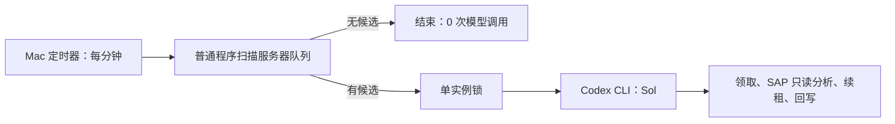

# ADR-0001：工单 AI 按需启动分析模型

## 状态

2026-10-14：用户已确认本版发布，切换完成，旧 `sap-ai` 为 PAUSED。无模型调度器通过本机 LaunchAgent 每分钟扫描，候选非空时按需启动 gpt-6.1-sol high；后台空队列扫描成功，未启动模型。

## 背景与目标

当前同一条 Codex 定时任务用 Sol 扫描队列并分析工单。服务器已通过 `ai_tickets list` 确定候选：只包含已由管理员受理、仍在处理中的“问题”工单，并排除已答复或租约受阻的轮次。这个判定不需要语言模型。目标是在空队列时不调用任何模型，同时保持约 1 分钟的发现延迟、Mac 上的 SAP 连通性、现有 `claim/renew/reply` 租约和人工抢先保护。

本机已核实 Codex CLI 使用 ChatGPT 账号登录，支持 `codex exec -m`；CLI 配置可见腾讯云 MCP。仍需在与定时器相同的后台环境中验证认证、MCP、公司技能及 SAP 只读工具可用。
本地具备 `launchctl` 和文件锁能力；一次服务器只读探针已把 `ai_tickets list` 收敛为 `enabled=True、ready=False、has_more=False`，没有把工单正文返回给扫描端。
候选扫描器在最小后台环境下返回 `SHADOW_EMPTY`；相关单实例锁、空队列零模型启动、旧心跳防双消费者、失败冷却测试通过。此验证尚不包括真实候选触发 Sol 的端到端工单处理。

## 决策

优先采用“无模型扫描 + 按需 Sol”：保留服务器现有候选接口，Mac 上用一个每分钟运行的普通脚本通过当前腾讯云管理通道读取候选状态。脚本只接收 `EMPTY/DISABLED` 或 `READY` 加候选元数据的短哈希，不记录工单正文、附件或租约令牌。`EMPTY` 时直接退出；`READY` 时持有本地单实例锁，启动一次 `codex exec -m gpt-6.1-sol -c model_reasoning_effort="high"`，由 Sol 在 Mac 上使用 `$sap-adt-hy` 进行最多 3 张工单的只读分析，并通过现有 `claim/renew/reply` 网关回写。Sol 退出后再做一次无模型扫描；候选哈希未变化时冷却 15 分钟，避免无进展的重复模型调用。

桌面心跳实际使用 `gpt-6.1-sol`。旧 Codex CLI v0.158.0 的 ChatGPT 登录拒绝该模型；在独立目录安装的官方 CLI v0.162.1 已用同一订阅账号通过 `gpt-6.1-sol high` 最小调用，未替换旧命令。按需处理器固定使用这个隔离版本。CLI 工作进程只装载腾讯云 MCP，并从本机凭据文件启动该工具；不加载与工单无关的远程 MCP。后台环境需带可用的本机代理设置，且代理地址不得包含账号或密码。
此前用 `gpt-6-sol` 完成了 REQ-00012 的 DS4/110 T001 只读试运行，但自动审批因当时缺少最终草稿确认拒绝了回写。用户随后明确要求改用 `gpt-6.1-sol high`，并明确“受理即授权自动回复”，包括顾问后续补充；本地协作规则已加入仅针对已发布工单工作流的例外。旧模型草稿没有发布，也不能视为新模型验收结果。新版 CLI 已通过腾讯云 MCP 连通性及精确的 DS4/110 T001 DDIC 只读预检（82 字段）；该 SAP 查询需要对单条命令申请 macOS 沙箱自动审批，不能放开整个执行沙箱。首次 6.1 试跑发生嵌套 Codex 进程，已终止并在提示词中禁止。新顾问触发41的复验确认只有一个 Sol 执行进程，并完成自动回写事件42。

Sol 处理器必须沿用当前自动任务的系统选择、PS4 精确授权、每工单查询次数、证据引用、失败退避与 45 分钟总期限。不能由扫描器领取任务，因为租约令牌应只交给实际处理器。扫描器与现有 Sol 心跳不能同时成为生产消费者；切换前先影子扫描，验证后暂停旧心跳，再启用按需启动。服务器的 `claim` 仍是并发和重复回复的最终门禁。

## 方案比较

| 方案 | 空队列模型调用 | 优点 | 代价 |
| --- | --- | --- | --- |
| 现状：Sol 每分钟扫描并处理 | 每次扫描调用 Sol | 已运行、审计链路成熟 | 空扫描仍消耗高端模型额度 |
| Luna 扫描、Sol 分析 | 每次扫描调用 Luna | 可以保留模型驱动的扫描判断 | 仍持续消耗模型额度，且需要安全的跨代理交接 |
| 无模型扫描、按需 Sol（推荐） | 0 | 最大幅度减少空扫描额度；筛选规则仍由服务端统一维护 | 需要维护本机定时器、CLI 进程与运行日志 |

## 失败处理与边界

- 定时器使用本机单实例锁；上一次 Sol 未结束时跳过新启动。Mac 休眠或离线时不处理，与当前自动任务的在线依赖一致。
- 扫描失败只记录无敏感内容的错误类别并在下分钟重试；绝不将错误当作 `READY`，也不自动领取。
- Sol 退出失败或前后候选哈希未变化时冷却 15 分钟，不因工单仍排队就在每分钟重新调用模型。
- Sol 启动后再次查询与领取，消除扫描至启动之间的竞态。人工回复、状态变化、租约失效或总期限到达时，旧答案不得回写。
- 用受限自动审批与现有沙箱运行 CLI；不得为定时任务启用绕过审批或全盘访问。独立进程达到有界超时可由本机调度器终止；服务器续租与回写门禁仍负责最终一致性。
- CLI 子进程不得把正文、SAP 返回或令牌写入普通轮询日志。保留必要的错误类别、工单编号及服务器审计；Codex 应用内原有 Scheduled 运行历史会被新的本机运行记录替代，需在验收时确认可追溯性。
- 生产运行保持旧 `sap-ai` 为 PAUSED；回退时先停止新调度器、确认子进程退出并删除启用标记，再恢复原心跳。已发布的工单回复不回滚。

## 验收条件

1. 空队列连续扫描时不启动 Codex CLI，Sol 调用数为 0；候选分页完整，扫描日志不含业务正文或凭据。
2. 单张与多张候选最多只启动一个 Sol 处理进程；一轮最多处理 3 张，余量留下一次触发。
3. 人工抢先回复、顾问补充、过期租约与 45 分钟期限仍由服务器门禁阻止重复回写。
4. 后台环境中订阅登录、腾讯云 MCP、`sap-adt-hy` 与 SAP 只读权限实测通过；不启动嵌套 Codex；受控验收失败后恢复旧任务。
5. 影子运行与一次受控工单验证后，再切换调度器；核对队列、通知、审计与回滚。

当前实现：[无模型扫描器](../../scripts/ai_ticket_scan.cjs)、[单实例调度器](../../scripts/ai_ticket_dispatch.py)、[按需处理提示词](../AI_TICKET_ON_DEMAND_PROMPT.md)、[LaunchAgent 模板](../../deploy/com.sapdesk.ai-ticket-dispatcher.plist.template)。运行门禁要求旧心跳暂停且本地启用标记存在，两项现已满足，LaunchAgent 已安装启用。9 项调度单测、空队列影子扫描、6.1 high 订阅与精确 SAP 只读预检已通过。REQ-00012 新触发 41 的单进程工单端到端验收成功：领取一次、实际 SAP 查询一次、自动发布事件 42，站内通知与钉钉 accepted 均已核对。用户确认后已切换并核实真实后台空队列扫描成功。

## 参考

- [OpenAI：Scheduled tasks](https://learn.chatgpt.com/docs/automations)
- [OpenAI：Codex 模型与 CLI `-m`](https://learn.chatgpt.com/docs/models)
- [OpenAI：不同子代理的模型设置](https://learn.chatgpt.com/docs/agent-configuration/subagents)
- 当前实现：[工单 AI 网关](../../backend/desk/ai.py)、[管理命令](../../backend/desk/management/commands/ai_tickets.py)、[运行说明](../AI_TICKET_AUTOMATION.md)
