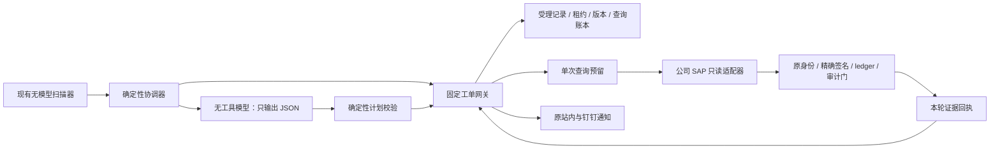

# 工单 AI 执行边界（已发布）

状态：2026-10-26，用户确认的所有前置验证已通过，版本 `permissions-20261024-ef8bb09dad4c` 已发布，详见[发布结果与实际限制](../reviews/ai-ticket-execution-boundary/rollout-2026-10-26.md)。10 月 24 日记录作为历史保留；没有推送代码或覆盖主开发目录的其他改动。

原后台每分钟直接加载 `/Users/apple/Desktop/SAP工作管理平台/scripts/ai_ticket_dispatch.py`。本地准备阶段在 `ticket-ai-permissions` 隔离工作树完成，没有提前影响该后台。确认发布后只切换本功能的云端后端及本机 LaunchAgent/独立运行包，其他 AI 的开发源码和 SAP 安全根均未修改。

## 改造后的执行链路



模型不持有工单租约、云工具、Shell、公司 CLI 或签名器。可信程序分别传入业务材料和完成的查询结果，接收结构化计划及答复候选。

## 已实现的边界

### 模型进程

- 固定现有 gpt-6.1-sol / high 与 CLI 0.162.1；版本不符直接停止，不自动换版本或扩大权限。
- 每次生成在空临时目录中运行，使用 read-only 沙箱、`approval_policy=never`、临时会话和 JSON Schema。
- 禁用 Shell、统一执行器、MCP、Apps、插件、hooks、浏览器、Computer Use、文件查看、图片生成、多代理、代码执行宿主、权限申请、宿主技能发现和其他执行面；不加载用户配置或项目文档。
- 不继承腾讯云、SAP、数据库、API 密钥或父聊天标识等环境变量。Codex 订阅认证仍由 CLI 自身处理，没有复制或输出订阅凭据。
- 单次生成最多 300 秒，输入最多 256 KiB；流式收发期间按单调时钟续租，并计入传输延迟。未知工具执行事件会终止进程及其子进程。
- 实际 CLI 请求已通过本机假接口捕获，`tools` 为空；使用合成 SSE 响应验证了完整的结构化输出，无外部模型调用。

### 工单与云传输

- 调度器只启动可信 Python 协调器，原模型启动参数中的 Lighthouse MCP 和 `--approve-for-me` 已移除。
- 固定网关只接收 `list / claim / renew / reply / defer / query_reserve / query_complete`；`get/retry` 保留在运维入口，不进入自动处理器。
- 不新增公开 HTTP 写入接口。传输器固定地域、实例、应用目录和管理命令，SDK 只调用现有 TAT 执行及结果查询接口。
- 业务文本先作为 JSON 编码为 base64，经标准输入交给固定管理命令；不接受任意命令、实例、地域或路径参数。固定 Bash 模板启用 pipefail，输出压缩后解码并做大小、完整性和 JSON 校验。
- 腾讯云凭据仅由可信传输进程读取，并检查单链接普通文件、归属、0600 和非符号链接；不会提供给模型。
- 列表只返回候选 id、编号和版本；完整材料仅在成功领取后交给本工单分析器。

### 受理范围和查询预算

- 在真实管理员受理时冻结系统/client、原始对象、源码类型、结构化业务键及受理说明摘要；后续轮次复用同一受理范围。
- 表权限不等于同名程序权限；源码的 fm/prog/class 类型也必须来自原始受理材料。
- 数据读取按已审阅的业务表、字段投影、等值业务键和 1–50 行上限校验。不允许任意 SQL/WHERE、裸 RFC、搜索全库、写操作、激活或传输。
- 默认“开始处理”和明确的通用只读受理说明可直接进入自动处理。无法确定性解释的额外受理说明保守转人工，不由另一个模型猜测限制、不要求管理员重复受理。
- 原工单已经明确的业务键不允许后续替换或追加。确实缺少必要键值时，仅允许由原提交人的真实补充，在已经受理的对象范围内补齐一次；这属于范围收窄，不授予新对象或新系统。
- `ticket-read-scope/v2` 以 `data_objects` 保存同一业务对象的键值关系，过滤条件必须匹配同一组。字段值索引不能作为跨组组合授权。明确对象的缺失键按对象补齐并记录补充事件，既定值保持不变。
- 旧 scope 只有值集合时，服务器可在原受理材料摘要及受理事件一致、且重建值均落在旧范围内的前提下确定性恢复关系，不要求重复授权；无法证明配对关系时拒绝自动 data 查询，不按出现顺序或后续消息重新配对。
- 每个工单轮次最多 8 次逻辑查询。预留即消耗额度，失败、断线、续租和重领不会退还或重置；相同 request_key 不会授权再次执行。
- 服务器事务按工单、任务顺序加锁，再校验租约和计数。保留原 15 分钟租约、首次领取起 45 分钟总期限、重试次数及人工抢先保护。
- 总期限不足 5 分钟时不再发起查询；单条查询回执期限最多 60 秒，协调器用单调时钟扣除完整预留往返耗时，过期响应不能启动新的 SAP 读取。本机适配器最多 55 秒、公司 CLI 最多 45 秒；原 PS4 内部 RFC budget 和超时继续生效。

### SAP 和证据回写

- DS4/QS4 继续使用公司现役 eyes 只读 CLI 和原连接身份核验，不引入其他连接器或凭据来源。
- PS4 使用原 policy 生成精确 scope，原 signer 签发全新短效 token，然后调用原 CLI。固定账号仍必须与 root profile 匹配；原信任、一次性 ledger、审计和输出门全部保留。
- 签名失败不改走无签名入口；不初始化、删除或重置信任根、审计链及 ledger。签名工件仅使用本轮 0600 临时文件。
- 可信适配器核对真实返回的 `_evidence` 系统/client、对象、命令和不可信标记，限制输出为 64 KiB，并对实际输出计算摘要。
- 服务器记录成功回执后，才产生 `sap-ticket-query:<UUID>` 证据引用。回写必须匹配当前任务、租约、上下文版本、系统/client 及成功记录；自由文本“引用”和其他工单/旧租约的回执不能发布。
- 自动回复继续使用原通知函数、AI 身份、版本和幂等机制，不改变工单状态。历史回复及其原引用保留。

## 当前能力范围与实际限制

- 首批自动查询只开放 `ddic / source / data / tcode`。其他公司只读命令仍可由既有受控运维流程使用，不自动暴露给工单模型；没有兜底 Shell。
- 自动数据读取的已审阅表为 MARA、MAKT、MARC、EKKO、EKPO、VBAK、VBAP、LIKP、LIPS、BKPF。未覆盖的表、字段或无法解析的业务范围会澄清或转人工；扩充目录需要代码审阅和发布确认。
- 范围编译不声称能理解任意自然语言授权。它使用明确对象、已审阅的业务映射及带标签的业务键；不能证明范围时拒绝执行。
- 模型仍可能生成错误解释或受到内容层面的诱导；本改造限制的是它能采取的行动和能发布的证据引用，不证明自然语言结论必然正确。
- 模型与协调器目前仍使用同一操作系统用户。模型无执行/文件工具是本次已经验证的能力边界；这不等于独立操作系统账号隔离，也不抵御同用户恶意本地进程。原本地 signer/ledger 仍属于诊断级本地安全设施。
- 已另建用户明确授权的专用 CAM 账号及独立凭据，未修改现有运维账号或密钥；结果读取的地域命令资源也已单独确认。DS4/QS4/PS4 真实联调均通过，具体范围与限制以最新发布记录为准。

## 本地验证证据

最终离线验证通过 217 项，另 1 项 PostgreSQL 并发用例因本机没有 PostgreSQL 而跳过：

| 验证 | 结果 |
|---|---|
| 调度器、协调器、固定传输、SAP 适配器、配置及实际 CLI | 38/38 通过，包含 2 项回环假接口验证 |
| 完整 desk + assistant 后端回归 | 166 项通过，1 项 PostgreSQL 并发测试跳过 |
| 公司现有签名、信任、精确 scope 和一次性 ledger 纯本地测试 | 13/13 通过，全部使用临时夹具 |
| Django 模型/迁移一致性 | `makemigrations --check --dry-run`：No changes detected |

覆盖原自动跟进、顾问多轮、通知、租约续期/重领、版本变化、人工抢先、期限、缺失键值补充，以及命令注入、跨系统/对象/源码类型、额外字段、超额查询、伪造引用、旧租约回执、签名失败和子进程停止。

可复现入口：使用已安装项目依赖的 Python 运行以下脚本。它强制内存数据库、临时媒体目录并关闭外部通知/模型服务，不读取生产数据库；额外选项仅执行回环模型夹具和现有签名纯单测。

```bash
python -B scripts/test_ai_ticket_execution.py \
  --cli-path /Users/apple/.codex/runtime/codex-cli-0.162.1/node_modules/.bin/codex \
  --company-workspace /Users/apple/Desktop/SAP项目独立工作区
```

CI 已加入新用例；PostgreSQL 环境下会运行“9 个并发预留最多成功 8 个”的事务测试。此次未推送，因此尚未声称远程 CI 已运行。

主要实现入口：

| 文件 | 审阅重点 |
|---|---|
| [无工具模型](../../scripts/ai_ticket_model.py) | 固定能力关闭、版本、临时目录、流式超时与子进程清理 |
| [确定性协调器](../../scripts/ai_ticket_worker.py) | 模型与租约分离、计划重验、传输耗时扣减、回执选择 |
| [受理范围策略](../../backend/desk/ai_policy.py) | 系统、对象类型、业务键、数据投影和禁止操作 |
| [固定网关](../../backend/desk/ai_gateway.py) | 事务锁、8 次额度、幂等预留和证据登记 |
| [工单回写](../../backend/desk/ai.py) | 保留原租约与人工抢先保护，拒绝无可信回执的引用 |
| [云传输](../../scripts/ai_ticket_transport.cjs) / [SAP 适配](../../scripts/ai_ticket_sap.mjs) | 固定命令数据通道及现有生产安全门复用 |
| [离线验证入口](../../scripts/test_ai_ticket_execution.py) | 强制内存数据库和合成依赖，避免触及线上 |

## 已执行的发布流程与后续发布约束

1. 取得针对本次最终内容的明确发布确认。保持旧 sap-ai heartbeat 暂停，停止当前 LaunchAgent，并备份数据库和当前程序；不能让旧执行器与新网关交错运行。
2. 先核对本地 main 与线上发布基线的差异；`ai.py` 中原有待发布退避修正不能未经审阅混入。随后在 PostgreSQL 验证迁移及并发额度用例，部署 `0013_ai_execution_boundary` 和固定管理网关。保留历史数据和在途任务期限，不重置旧轮次。
3. 核验腾讯云 CAM：只保留确实需要的 TAT 操作，并按各 API 实际支持的资源/地域条件限制目标实例。不能把代码里固定实例误称为 CAM 已经缩权；需要资源 `*` 的结果查询操作也不能附带其他管理权限。
4. 核验模型运行目录、CLI 版本及宿主配置，重新执行空工具列表捕获。后续可将协调器/签名器与模型运行身份分开部署，并让模型身份不能读取云/SAP 凭据目录；不能将 0600 误称为同用户进程间隔离。
5. 配置 `AI_TICKET_SAP_WORKSPACE` 和与 root profile 一致的 `AI_TICKET_PS4_APPROVED_USER`。用 `render_ai_ticket_launchd.py --mode run --sap-workspace <公司工作区> --ps4-user <固定账号>` 生成并审阅 plist；脚本仅生成文件，不安装或启动。缺配置时拒绝生成运行版本。
6. 对已受理范围内的受控工单做真实传输/SAP 只读验收，验证 gzip 回传、公司凭据助手、生产签名、证据回执和通知；不得扩大单据范围或执行 SAP 写入。
7. 只有上述检查通过后才创建独立标记 `release/ai-ticket-execution-boundary-enabled`，安装/恢复已审阅的 LaunchAgent。旧 `ai-ticket-dispatch-enabled` 标记不能单独启用本次执行器。

暂停或回退时，先停止调度并移除新标记，必要时关闭服务器 AI 功能开关。保留新查询账本、历史审计与租约记录，不自动恢复带通用工具的旧模型工作流；恢复旧工作流必须另行明确确认。


## 待发布：受控对象类型确认与受阻原因

本节是待本轮确认的增量，不表示已经改变线上行为。

- 类型可以从原始受理标题、正文中与同一精确对象明确关联的类型文字识别；旧范围只有在受理事件、系统/client、原始内容摘要一致且没有未解析限制时，才能补回当时已明确的单一类型。已绑定类型不能替换，顾问后续文本不能新增对象或自动改变类型。
- 原文只写“接口”而未明确技术类型时，仍不按名称猜测或由模型自行授予类型。仅针对用户明确要求继续的单个已受理工单，可信运维入口可依据公司现役只读工具的**精确名称**目录结果，确认唯一类型并创建一次独立新轮次。确认仅支持 DS4/QS4，拒绝带 LIKE 通配含义的名称、跨系统、跨对象、多个类型、受理限制不明及既有类型冲突。PS4 的目录搜索禁令不变。
- 运维人员必须自己通过公司工具核对实际系统、client、对象和唯一类型，再在五分钟内提交结果；服务器检查数据结构和内容 SHA-256，但**摘要不是签名，也不单独证明 SAP 身份或采集时间**。该动作信任有权限的运维调用者，不开放给模型、自动工单网关或公开 HTTP。
- 新轮次必须基于当前工单版本、当前管理员受理及已终止的受阻轮次；旧轮次不能有任何 SAP 查询预留。请求采用幂等键，保留旧期限、尝试、查询账本和审计，不伪造顾问/管理员回复。新轮次仍遵循每轮 8 次查询、15 分钟租约、45 分钟期限、人工抢先保护和当前证据回执规则。
- 受阻时仅存储封闭白名单中的原因类别，不保存模型原文、工单正文或异常文本。明确缺少源码类型时直接转人工，其他失败继续遵循现有退避规则；达到时间限制时，时间终止原因与先前受阻原因分别保留。旧审计只有笼统类别的，不推断历史具体错误。
